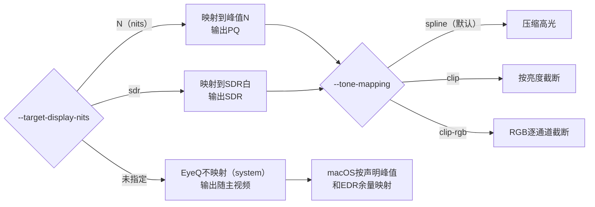

# HDR显示与亮度映射说明

本文说明EyeQ播放HDR内容时，画面亮度经过了哪些映射；相关选项如何决定这些映射；在macOS桌面、DeckLink监视器这两种输出上分别会发生什么；以及Dolby Vision、HDR Vivid等动态元数据源和多视频对比时需要注意的地方。

文中区分两类结论：

- **实测**：用ScreenCaptureKit截取送屏像素，或用Ctrl+E保存EyeQ的输出帧得到的数据（2026-10，macOS 27）。
- **推断**：根据代码、上游库源码或Apple公开约定得出，尚未用仪器验证。

实测使用的显示器是Apple Pro Display XDR，峰值亮度1600 nits（Apple标称全屏持续亮度1000 nits）。默认预设为“Pro Display XDR (P3-1600 nits)”：HDR峰值1600 nits，SDR亮度上限500 nits。参考预设“HDR Video (P3-ST 2084)”：峰值1000 nits，SDR白100 nits。其他显示器的余量、预设和系统映射可能不同，本文的数值不能直接套用。

## 1. 术语

| 术语 | 含义 |
|---|---|
| PQ | HDR10使用的传输函数（SMPTE ST 2084）。PQ码值对应绝对亮度，范围0–10000 nits |
| 母版峰值 | 源的mastering display元数据中的最大亮度，如1000或4000 nits。Dolby Vision取RPU中的source_max_pq。缺失时可用`--default-mastering-nits`补上 |
| MaxCLL | 内容中最亮像素的亮度（静态元数据）。它可以略高于母版峰值，例如1000 nits母版的内容里出现1010 nits。EyeQ的映射不使用它，只把它原样交给macOS |
| 映射目标 | EyeQ把所有源统一映射到的显示条件，由`--target-display-nits`指定：峰值为N的HDR显示，或SDR显示。没有默认值 |
| tone mapping | 把超过目标上限的亮度处理到上限以内：压缩高光，或者截断。源峰值不超过目标时不做处理 |
| 声明峰值 | 输出PQ时，EyeQ随窗口交给macOS的母版峰值，描述EyeQ实际输出的画面最亮有多亮。只是元数据，不改动像素 |
| EDR | macOS的HDR显示机制。画面数值以“SDR白 = 1.0”为单位 |
| EDR余量 | 当前允许的最大EDR值，即HDR最亮能达到SDR白的多少倍。随亮度设置、预设和是否有HDR内容变化 |
| 参考模式 | Apple XDR显示器的参考预设，例如“HDR Video (P3-ST 2084)”。此时SDR白固定为100 nits，峰值固定为1000 nits |

## 2. 整体链路

```
源（PQ / HLG / SDR，可带静态或动态元数据）
  │  ① EyeQ映射：每个源各自映射到同一个映射目标（libplacebo）；没有映射目标时不映射
  ▼
公共结果（所有视频在同一亮度空间内对比、切换、滑动）
  │  编码为输出信号（PQ或SDR）
  ├─► macOS桌面窗口 ──② 系统映射（EDR）──► 显示器
  └─► DeckLink输出 ─────────────────────► 监视器（③ 监视器自身处理）
```

- ①由EyeQ完成，是否映射、怎么映射、映射到哪里，由第3节的两个选项决定。
- ②只存在于macOS桌面的PQ输出，由系统完成，EyeQ无法控制，只能通过声明峰值影响它（第4.4节）。SDR输出是普通图层，系统不做亮度映射。
- ③取决于监视器本身：专业参考监视器通常按绝对亮度显示PQ，超过面板峰值的部分截断；消费级电视可能自行做tone mapping。

## 3. 选项与规则

使用者只需要回答两个问题：**EyeQ要不要映射、怎么映射**（`--tone-mapping`）；**映射到哪里**（`--target-display-nits`）。



### 3.1 映射到哪里：`--target-display-nits <nits|sdr>`

| 取值 | 含义 | 输出 |
|---|---|---|
| 不指定 | 没有映射目标，EyeQ不映射 | 随主视频：主视频为HDR时输出PQ，为SDR时输出SDR |
| `N` | 目标是峰值为N nits的HDR显示 | PQ |
| `sdr` | 目标是SDR显示，映射目标峰值为SDR白（203 nits） | SDR |

没有默认值。映射目标决定输出，主视频只在没有映射目标时起作用。

### 3.2 怎么映射：`--tone-mapping {system,clip,clip-rgb,spline}`

| 取值 | 含义 |
|---|---|
| `system` | EyeQ不映射，输出交给系统映射，与QuickTime的做法一致。不指定映射目标时的默认值 |
| `spline` | 压缩高光（libplacebo的spline曲线）。指定了映射目标时的默认值 |
| `clip` | 截断到映射目标，保持色调：超出的像素按最大通道等比缩小到目标峰值 |
| `clip-rgb` | R、G、B各自截断到映射目标 |

`clip`与`clip-rgb`的区别（实测，1000 nits母版测试片，映射目标300 nits）：

| 源像素（R、G、B，nits） | `clip` | `clip-rgb` |
|---|---|---|
| 626、513、347 | 300、247、167 | 300、300、300 |
| 620、294、225 | 300、142、109 | 300、294、225 |

- 两者都不改动范围内的像素（实测：最大通道低于目标的像素，变化不超过10-bit量化误差，约3 nits）。
- `clip`保持颜色的比例关系，超出的像素整体变暗。
- `clip-rgb`把超出的通道压平，颜色会偏白或偏色。
- 映射目标为`sdr`时，`clip-rgb`在最终输出色域里逐通道截断；`clip`在BT.2020映射目标中等比缩小，转到输出色域时超出色域的饱和色仍会被逐通道截断。
- 两者都是EyeQ自己实现的。libplacebo的clip函数按IPT亮度处理，接近峰值的饱和色即使每个通道都没有超过目标也会被压暗（实测个别像素达几十nits），因此没有采用。

**动态元数据**：源启用了动态元数据自带的映射时，该源不受`--tone-mapping`影响。目前只有`--hdrvivid-render`下的HDR Vivid；以后加入HDR10+、SMPTE ST 2094-50的自带映射时同样适用。HDR10+和Dolby Vision的动态元数据现在只用来确定源的场景峰值，映射方式仍由`--tone-mapping`决定。

### 3.3 两个选项的组合

| `--target-display-nits` | `--tone-mapping` | 结果 |
|---|---|---|
| 未指定 | 未指定或`system` | EyeQ不映射，输出随主视频 |
| 未指定 | `clip` / `clip-rgb` / `spline` | 报错：缺少映射目标 |
| `N`或`sdr` | 未指定 | 按`spline`映射到目标 |
| `N`或`sdr` | `clip` / `clip-rgb` / `spline` | 按指定方式映射到目标 |
| `N`或`sdr` | `system` | 报错：冲突 |

### 3.4 必须指定映射目标的情况

EyeQ不替使用者选择映射目标。下列情况不指定就报错退出：

| 情况 | 需要 |
|---|---|
| 主视频为SDR，同时有HDR视频 | `sdr`（输出SDR）或`N`（输出PQ，SDR视频按参考白放入） |
| 全局`--icc-profile`，同时有HDR视频 | `sdr` |
| `--monitor-device` | `N`（PQ监视器的峰值）或`sdr`（SDR监视器） |
| `--hdrvivid-render` | `N`或`sdr`，作为Vivid曲线的目标显示亮度 |

其他冲突：

- 全局`--icc-profile`只描述SDR显示，不能与数值目标`N`同时使用。全局ICC不会修改其他选项，只参与这些检查。只给某一路视频指定ICC（`N:路径`）不受限制。
- `--monitor-color`显式指定的值必须与映射目标一致：`pq2020`配`N`，`sdr709`配`sdr`。`auto`随映射目标决定。
- 请求了PQ输出而平台不提供HDR窗口格式时，EyeQ报错退出，并提示改用`--target-display-nits sdr`，不会静默截断。macOS上不会出现这种情况。

### 3.5 输出由什么决定

输出是PQ还是SDR，取决于EyeQ交给窗口的色彩空间，**不取决于显示器**：

- 实测：在SDR显示器（PHL 278B1）上播放PQ主视频，窗口仍是PQ（`HDR10_ST2084`），由macOS映射到SDR。EyeQ会告警，提示可以改用`--target-display-nits sdr`让EyeQ自己映射。两种做法哪个效果更好，尚未对比。
- 映射目标为`sdr`时：有全局ICC则使用ICC的色彩空间；主视频为SDR则使用主视频的色彩空间；主视频为HDR则使用sRGB。

### 3.6 选项速查

| 选项 | 作用 | 要点 |
|---|---|---|
| `--target-display-nits <N\|sdr>` | 映射目标，同时决定输出 | 没有默认值；不指定时EyeQ不映射 |
| `--tone-mapping` | 映射方式 | 没有目标时为`system`，有目标时默认`spline` |
| `--default-mastering-nits N` | 给缺少母版峰值的HDR源补峰值 | 不改动已有峰值的源，不改MaxCLL（第6节） |
| `--main` | 主视频 | 没有映射目标时决定输出；交给系统的MaxCLL、MaxFALL来自主视频 |
| `--reference-white N` | SDR参考白，默认203 | SDR视频放入HDR输出时的白；监看时还作为SDR监视器的白 |
| `--hdrvivid-render` | Vivid源使用Vivid曲线 | 必须指定映射目标；不受`--tone-mapping`影响 |
| `--icc-profile` | ICC色彩管理 | 全局ICC意味着SDR输出；监看时无效 |
| `--monitor-device` | DeckLink监看 | 必须指定映射目标 |

## 4. macOS桌面：参考模式与非参考模式

本节只涉及PQ输出。

### 4.1 参考模式：系统不再压缩

切到“HDR Video (P3-ST 2084)”等参考预设后：

- 实测：EDR余量为10，`reference`值为10，即峰值1000 nits ÷ SDR白100 nits。
- 实测：送屏EDR值 × 100与源亮度一致（7 nits的源 → 7.4，100 → 101.6，613 → 625），EyeQ与QuickTime相差0.3%以内。也就是说，系统按绝对亮度把PQ送到显示器；显示器实际发出的亮度未用色度计测量。
- 实测：声明峰值不影响画面。1000与4000 nits母版的测试片（画面相同，最亮约880 nits）送屏像素一致。

因此只有EyeQ的映射①生效。映射目标等于显示器峰值（`--target-display-nits 1000`）时，屏幕上的亮度就是EyeQ计算出的亮度。**做主观质量评估、HDR效果判断、tone mapping评估时，应使用参考模式并指定映射目标。**

### 4.2 非参考模式：系统再映射一次

默认预设（如“Pro Display XDR (P3-1600 nits)”）下：

- PQ不再按绝对亮度显示，而是按当前SDR亮度相对放大或缩小。
- 超过当前EDR余量的部分，由系统再做一次tone mapping。
- 系统的映射会参考声明峰值（第4.4节）。

实测（默认预设，EDR余量4.1，1000 nits母版的测试片）：

| 源亮度 | 送屏EDR值 | 每1.0 EDR对应的源亮度 |
|---|---|---|
| 7 nits | 0.047 | 约155 nits |
| 100 nits | 0.62 | 约160 nits |
| 200 nits | 1.19 | 约167 nits |
| 490 nits | 2.50 | 约197 nits |
| 610 nits | 2.95 | 约208 nits |

可以看到中间调近似线性（约160 nits对应SDR白），高光被系统逐渐压缩。这条曲线由系统决定，会随亮度滑块、自动亮度和环境光变化，上表只代表这一次测量。

非参考模式的影响：

1. 绝对亮度判断不可信，例如“高光是否达到880 nits”。
2. 暗部和高光的可见程度和实际观看条件不同，对暗部差异可能偏严、对高光差异可能偏松。
3. 同一时刻所有视频经过同一条系统映射，**A/B相对比较仍然公平**。

输出PQ、显示器不在参考模式时，EyeQ会在启动时给出警告。

### 4.3 与QuickTime对比

QuickTime（AVFoundation）不自己压缩HDR10，而是把源元数据交给系统映射。EyeQ不指定映射目标时做法相同。

实测（非参考模式，EDR余量4.2，同一时间截取两个播放器的送屏像素）：

| 测试片 | EyeQ设置 | EyeQ ÷ QuickTime |
|---|---|---|
| 1000 nits母版 | 不指定映射目标 | 0.996–0.997 |
| 4000 nits母版 | 不指定映射目标 | 0.996–0.997 |
| 1000 nits母版 | `--target-display-nits 1000` | 0.996–0.997 |
| 4000 nits母版 | `--target-display-nits 1000` | 0.93–1.01 |

前三行剩下的差别不随亮度变化，参考模式下也是如此。两者的色彩转换都由macOS完成（EyeQ把BT.2020/PQ色彩空间交给窗口）。按通道看：

| EyeQ设置 | R | G | B |
|---|---|---|---|
| 默认（色度上采样`lanczos`） | 0.992 | 0.998 | 0.995 |
| `--plane-scale-method bilinear` | 0.995 | 0.996 | 0.996 |
| `--plane-scale-method nearest` | 0.996 | 0.996 | 0.996 |

（EyeQ ÷ QuickTime，非参考模式。）

- 换色度上采样算法后，各通道的比例会变：`bilinear`、`nearest`下三个通道一致，`lanczos`下R、B比G低。这说明色度上采样参与了差别。
- 但换算法并没有让结果整体更接近QuickTime：G通道反而从0.998变为0.996。所以只能推测差别来自解码实现的不同（色度上采样、YUV转RGB等），QuickTime具体用什么算法未知。以上只是一次截图的结果。

最后一行差别更大，这是预期的：EyeQ先把4000 nits的源压缩到1000 nits，高光的曲线形状由EyeQ决定。

对比时注意：QuickTime失去前台时，会把HDR高光压到EDR约1.36（系统余量不变）；EyeQ不会。肉眼对比两个播放器时，被观看的那一个必须在前台。

### 4.4 交给macOS的HDR元数据

输出PQ时，EyeQ随窗口把一份HDR静态元数据交给系统（经libplacebo和MoltenVK设置到窗口图层的`CAEDRMetadata`）。这只是元数据，不改动任何像素：

| 数值 | EyeQ填写的内容 |
|---|---|
| 母版峰值（声明峰值） | 有映射目标N时：min(N, 所有HDR源母版峰值的最大值)。没有映射目标时：所有HDR源母版峰值的最大值 |
| MaxCLL、MaxFALL | 主视频的值，原样转交 |

- 声明峰值在开头几帧计算一次，之后固定，与哪个视频是主视频无关。
- 只使用静态母版峰值（已应用`--default-mastering-nits`），不使用MaxCLL和动态元数据。
- HDR源缺少母版峰值时，EyeQ告警，并按PQ上限10000 nits计算，画面会偏暗。

声明峰值会改变系统映射②。实测（非参考模式，EDR余量4.1，同一测试片，每次只改一项元数据，EyeQ都不压缩）：

| 改动 | 暗部 | 中间调 | 高光 |
|---|---|---|---|
| 母版峰值1000 → 4000 nits | 暗16% | 暗26%–29% | 暗35%–41% |
| 母版峰值1000 → 600 nits | 亮5% | 亮8%–9% | 亮5%–9% |
| MaxCLL 1000 → 4000 nits | 无变化 | 无变化 | 无变化 |

- 系统按声明峰值决定把内容压缩多少。声明的峰值越高，画面整体越暗，暗部和中间调也会变暗，不只是高光。这次测量中MaxCLL没有影响。
- 参考模式下不影响（实测，内容不超过显示器峰值1000 nits时；超过时未测量）。
- DeckLink监视器不受影响，EyeQ不向监视器发送母版和MaxCLL元数据。
- Ctrl+E保存的帧，像素不受影响。

## 5. 是否指定映射目标

| 目的 | 推荐设置 |
|---|---|
| 日常浏览，希望与QuickTime观感一致 | 不指定映射目标 |
| 主观质量评估、绝对亮度判断 | 参考模式 + `--target-display-nits 1000` |
| 需要可复现的渲染帧，或跨机器一致 | 指定映射目标 |
| 在SDR显示器上由EyeQ决定HDR如何映射 | `--target-display-nits sdr` |
| 模拟参考监视器超出峰值即截断 | `--target-display-nits N --tone-mapping clip`或`clip-rgb` |

不指定映射目标时：

- EyeQ不压缩源，显示效果完全依赖系统映射，随亮度设置和显示器变化，不适合复现绝对亮度。
- 多个视频时，声明峰值取最大的母版峰值。母版峰值较低的视频会比单独播放时暗（第4.4节）。
- 参考模式下，画面中超过显示器峰值（1000 nits）的部分由系统处理，具体是截断还是压缩尚未验证。

指定映射目标时：

- EyeQ的映射①与机器、显示器设置无关，同一命令得到相同的Ctrl+E渲染帧。
- 非参考模式下系统仍会再映射一次，但声明峰值不超过映射目标，不会按源的更高峰值重复压缩。

**映射到SDR**（实测，`--target-display-nits sdr`，1000 nits母版测试片，Ctrl+E保存帧）：

| `--tone-mapping` | 到达SDR白的像素 | 说明 |
|---|---|---|
| `spline` | 0.17% | 最亮处为SDR白的0.82倍，高光保留层次。剩余的0.17%推测来自BT.2020到BT.709的色域截断 |
| `clip` | 2.10% | 超出的像素等比缩小，绝大多数只有一个通道到顶 |
| `clip-rgb` | 2.10% | 超出的通道各自截断，多数像素三个通道都到顶（变白） |

**Ctrl+E保存的是什么**：EyeQ呈现到桌面窗口的最终画面，也就是映射①之后、交给macOS之前的结果，不包含系统映射②。

- 分辨率是窗口的像素尺寸，不是视频分辨率；包含当前显示模式的布局（Slide分割线、Grid网格、留黑边）和屏幕上显示的OSD文字。
- 按窗口当前的输出编码：PQ/BT.2020或SDR。DPX文件头记录了transfer、primaries和峰值。
- 不指定映射目标时，保存的帧没有经过压缩，亮度可达源的峰值。
- 因为不含系统映射，非参考模式下保存的帧和屏幕上看到的亮度不同；参考模式下两者一致（实测送屏像素与绝对亮度一致）。
- 回看保存的DPX时，FFmpeg读不出文件头里的PQ/HLG和峰值（第6节），需要`setparams`加`--default-mastering-nits`。峰值填保存时的输出峰值：指定过映射目标时为该值，否则为源的母版峰值。

## 6. 源的母版峰值

EyeQ的映射①和声明峰值都依赖源的母版峰值。缺少母版峰值的PQ源会被当作最高10000 nits：指定了映射目标时被过度压缩，不指定时声明峰值过高，两种情况画面都偏暗。EyeQ会对这样的源告警。

`--default-mastering-nits N`给缺少母版峰值的HDR源补上峰值：

- 只补缺失的源，已有母版峰值的源不改动。Dolby Vision没有mastering元数据时，libplacebo会从RPU取得峰值，不算缺失。
- MaxCLL和动态元数据不改动。MaxCLL高于N时只告警。
- 生效时每一路打印一条日志。

EyeQ通过FFmpeg读取元数据，只有FFmpeg放进AVFrame（或流）side data里的mastering display / MaxCLL才能被使用。即使文件格式本身能记录峰值，FFmpeg不解析时EyeQ也拿不到：

| 格式 | 文件能否记录 | FFmpeg是否解析（以FFmpeg 9.0源码为准） |
|---|---|---|
| HEVC/AV1等视频码流，MP4/MOV/MKV容器 | 能（SEI、OBU或容器字段） | 解析，生成mastering / CLL side data |
| JPEG XL | 色彩编码能标PQ/BT.2020；峰值记录在`intensity_target`字段 | 只解析色彩编码，不读取`intensity_target`，没有峰值side data |
| DPX | SMPTE ST 268:2014定义了PQ/HLG的transfer码值，EyeQ的Ctrl+E会写入峰值（reference high quantity）；没有标准的mastering/MaxCLL字段 | transfer/colorimetric只识别到旧码值，不识别PQ/HLG，也不读取峰值；结果是色彩空间未知、没有峰值 |

`setparams`滤镜只能修改primaries、transfer等色彩标签，不能补充峰值side data，所以这类文件需要`setparams`和`--default-mastering-nits`一起使用。其他图像格式（如PNG、AVIF、TIFF）未逐一核实。

母版峰值在映射①中的作用（依据libplacebo 7.360源码）：

- 静态HDR10源：按母版峰值映射。
- HDR10+源：libplacebo用HDR10+的场景maxRGB取代母版峰值。
- Dolby Vision源：RPU带L1时，libplacebo用L1的场景亮度取代母版峰值。
- HDR Vivid源加`--hdrvivid-render`时：Vivid曲线直接读取码流中的母版元数据。

## 7. DeckLink监视器

使用`--monitor-device`时：

- 必须指定映射目标。`--target-display-nits N`输出PQ信号，N应设为监视器的实际峰值，EyeQ不猜测；`--target-display-nits sdr`输出BT.709 / BT.1886信号，映射目标为`--reference-white`。
- PQ信号只声明PQ与BT.2020，不附带mastering和MaxCLL元数据（避免写入与实际输出不符的值）。
- macOS的EDR不参与，不存在第二次系统映射。
- 监视器如何显示由监视器决定。参考监视器按绝对亮度显示，超出峰值会截断；`--tone-mapping clip`或`clip-rgb`可以让EyeQ按同样的方式处理。
- 桌面窗口和监视器使用同一份映射结果，但桌面窗口仍会经过第4节的系统映射，两者看起来可能不同；以监视器为准。

## 8. 动态元数据的源

动态元数据按场景或逐帧描述亮度，用于把内容适配到不同亮度的目标显示器。它是否改变画面取决于标准和实现，不能简单地以“源峰值是否超过目标”判断：

- 有的方案只在目标显示器比母版暗时压缩，目标更亮时保持原样；有的方案（如HDR Vivid曲线、Dolby的显示管理）会根据目标显示亮度调整整条曲线，目标更亮时也可能提亮或调整饱和度。
- EyeQ中由libplacebo处理的动态元数据（Dolby Vision L1、HDR10+）只提供源的场景峰值：EyeQ未开启反向tone mapping，场景峰值不超过映射目标时不改变亮度（推断，依据libplacebo默认参数）；超过时按`--tone-mapping`指定的方式映射。
- EyeQ中的HDR Vivid曲线（`--hdrvivid-render`）按元数据中的目标显示亮度和映射目标求解，即使源峰值不超过目标，也可能改变画面；它不受`--tone-mapping`影响。

不指定映射目标时，EyeQ不映射，动态元数据不起作用；系统只收到静态元数据（推断）。

### 8.1 Dolby Vision

- EyeQ：由libplacebo解析RPU，完成重塑（reshape），并使用L1场景亮度信息。libplacebo不实现Dolby官方的完整显示管理，例如L2/L8 trim（未核实），所以和Dolby认证设备的效果可能不同。
- QuickTime：macOS原生支持Dolby Vision，使用系统的Dolby显示管理和动态元数据。**因此Dolby Vision在EyeQ和QuickTime中本来就可能不一致**，不指定映射目标也不能消除这个差异。

### 8.2 HDR Vivid

- 不加`--hdrvivid-render`：Vivid动态元数据被忽略，按普通PQ（HDR10）处理。
- 加`--hdrvivid-render`：必须指定映射目标，EyeQ按Vivid曲线把源映射到该目标。这是对“目标显示器”的模拟，所以：
  - 参考模式或DeckLink监视器下，屏幕亮度就是Vivid曲线的结果，适合评估Vivid。
  - 非参考模式下，系统还会再映射一次，**不适合评估Vivid效果**。
  - 映射目标为`sdr`时，曲线按SDR白求解，效果尚未验证。
- QuickTime不使用HDR Vivid动态元数据（推断），按HDR10静态元数据处理。

### 8.3 HDR10+

由libplacebo处理：场景峰值高于映射目标时参与映射。EyeQ没有启用HDR10+自带的映射曲线。尚未与QuickTime对比。

## 9. 多个视频

- 所有视频映射到**同一个**映射目标，在同一亮度空间内对比；EyeQ不会为每个视频单独选目标。
- 每个视频按**自己的**元数据映射。同一内容如果元数据不同（例如一个4000 nits母版、一个1000 nits母版），指定映射目标后画面会不同，这是元数据差异的真实结果。
- 系统映射（第4节）只有一条，声明峰值只有一个，取自所有HDR源（第4.4节）。切换主视频不改变声明峰值。
- HDR和SDR视频一起对比：
  - 主视频为HDR时，SDR白按`--reference-white`（默认203 nits）放入HDR输出。非参考模式下，它在屏幕上的亮度会随系统映射变化，可能比桌面上的SDR白亮。
  - 主视频为SDR时，必须指定映射目标（第3.4节）。
- 动态元数据只影响带有它的视频。与不带动态元数据的视频对比时，差异可能来自映射方式，而不只是编码质量。做近无损对比时，建议让源峰值不超过映射目标，并且不开启`--hdrvivid-render`，使所有视频都不经过压缩。

## 10. 已知限制与未验证项

- 参考模式下“PQ按绝对亮度显示”只测量了送屏像素，显示器实际亮度未用色度计测量；画面超过1000 nits时系统如何处理未测量。
- 非参考模式下系统映射曲线未公开，本文数据仅为一次测量。
- SDR显示器上，“交给macOS映射”与“EyeQ映射到SDR”的效果尚未对比。
- Dolby Vision、HDR10+在EyeQ和QuickTime之间尚未做截图对比。
- DeckLink监看的规则改动（必须指定映射目标、`--monitor-color auto`随映射目标）只经过参数检查，未在设备上验证。
- Linux、Windows上不指定映射目标时由系统合成器处理HDR，效果未验证。
- 第三方HDR显示器在macOS下的行为未测试。
